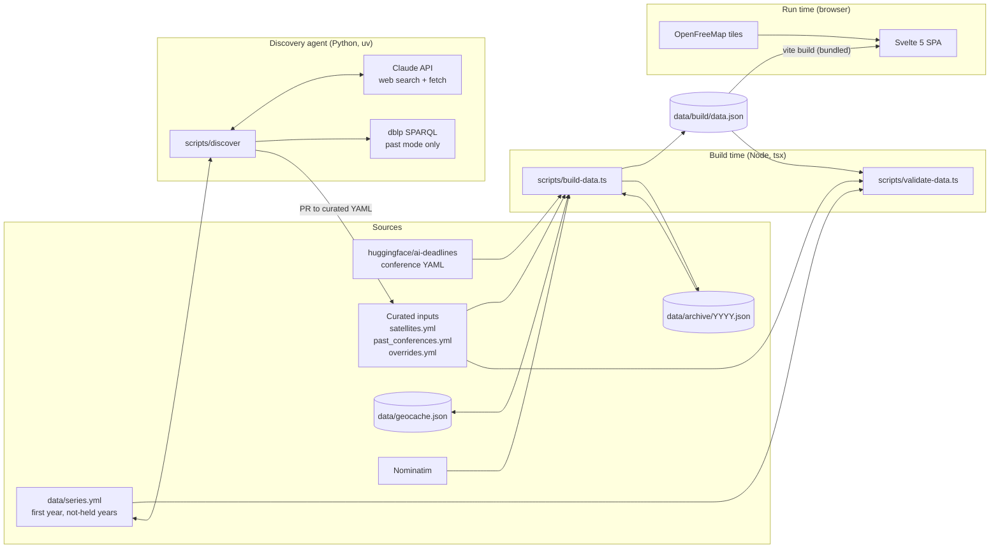
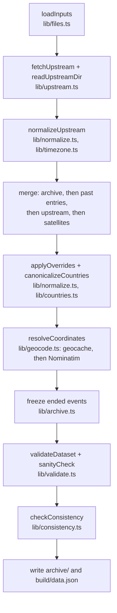
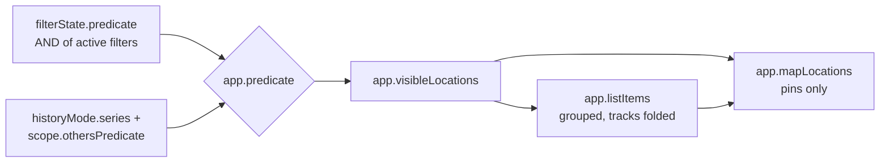
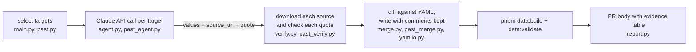
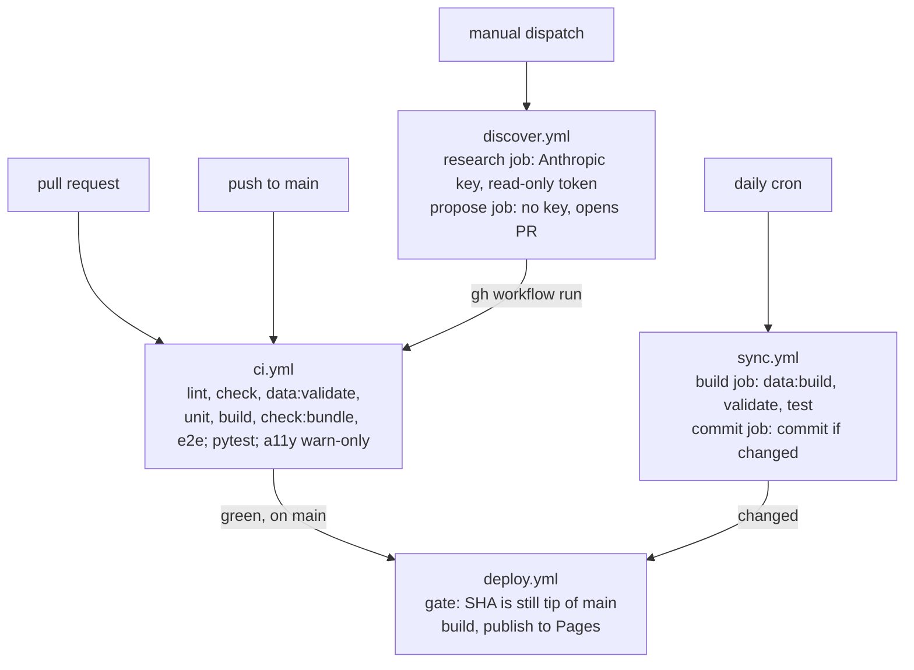

# confmaps system architecture

This document describes how the code is organized: the components, their boundaries, how data
moves between them, and the abstractions that hold them together. It is the map of the code.
The product and behaviour decisions (what the app does, and why) are in `DESIGN.md`; this
document links to its sections instead of restating them.

## 1. Overview

confmaps.org is a map of AI conferences and their regional satellite events. A researcher can
see where and when each event takes place, and estimate the distance and CO₂ of attending each
location from their home city.

The system has no server. It has two halves that meet at one file, `data/build/data.json`:

- **Build time** (Node scripts in GitHub Actions): fetch upstream conference data, merge it with
  hand-curated files and the archive, geocode cities, validate everything, and write
  `data.json`. A separate Python agent proposes new data through pull requests.
- **Run time** (a Svelte 5 single-page app in the browser): bundle `data.json` into the
  JavaScript, then compute every per-viewer value (filters, distance, CO₂, timeline) on the
  device. The viewer's home city never leaves the browser.

GitHub Pages serves the built site. The repository is public, so every data change is reviewable
in git history.

## 2. System diagram



The architecture is a static-site generator with a client-side application. The important
property is the direction of data: everything flows into `data.json`, and the app only reads it.
Nothing at run time writes back.

## 3. Repository layout

```
data/                     inputs and outputs of the data pipeline
  satellites.yml          curated satellite events
  past_conferences.yml    past main editions (source of truth since the PwC import)
  overrides.yml           per-location field fixes, keyed by location id
  series.yml              first year and not-held years per series; checked by build (not emitted),
                          read and written by discover
  geocache.json           "city|country" → coordinates (reviewed in diffs)
  co2-factors.json        DESNZ emission factors, read by the app
  archive/YYYY.json       every event that has ended; never shrinks
  build/data.json         generated output, committed
scripts/                  build-time TypeScript (run with tsx)
  build-data.ts           pnpm data:build (entry point)
  validate-data.ts        pnpm data:validate (entry point)
  check-bundle-size.ts    pnpm check:bundle: main JS bundle ≤ 400 kB gzip (CI, after build)
  import-pwc.ts, pwc/     one-time PwC importer and its fixes
  build-cities.ts         regenerates public/cities.json from GeoNames
  schema.ts               Zod schemas for every data file; app types derive from it
  lib/                    pipeline stages (see §5)
  discover/               Python discovery agent (uv project, its own tests)
src/                      the Svelte app
  main.ts, App.svelte     entry point and layout shell
  components/             Svelte components; filters/ holds each filter's control
  lib/data/               load and join data.json
  lib/state/              app-wide reactive state (runes), URL sync, storage
  lib/filters/            the filter contract, registry and one file per filter
  lib/timeline/           pure timeline maths: window, scale, motion, history path
  lib/map/                MapLibre style, GeoJSON builders, animation
  lib/home/               home city: store, city search, footprint helpers
  lib/co2/                CO₂ model and number formatting
  lib/geo/, lib/format/   haversine distance; date and label formatting
  styles/                 design tokens and base CSS (glass classes)
public/                   cities.json, CNAME, favicon
e2e/                      Playwright tests (smoke, mobile, a11y, past editions)
.github/workflows/        ci, deploy, sync, discover
```

Unit tests sit next to their module (`*.test.ts`). Vitest runs both `src/` and `scripts/` tests.

## 4. Core concepts

### Conference and location

The data model separates **what** an event is from **where** it happens.

- A **`Conference`** is one edition of a series: `neurips26`, `icml19`. It holds the title,
  dates, deadlines, tags and its `source`.
- An **`EventLocation`** is one place where that edition happens. Every conference has one
  **main** location, with the id `<conferenceId>@main`. A conference can also have any number of
  **satellite** locations, each with its own id, city and dates.

Filters, the map and the CO₂ model all work per location. The list groups locations back into
conferences. This is why the NeurIPS 2026 row can show both Sydney and Paris, and why a filter
can hide Sydney while it keeps Paris.

`EventLocation` is a discriminated union on `format`:

- **`PinnedLocation`**: in person or hybrid. It has a city, a country and coordinates.
- **`VirtualLocation`**: an online-only past edition. It has no place and no coordinates.

Code must call `isVirtual()` (`scripts/lib/virtual.ts`) before it reads coordinates. In the app,
`isPinned()` and the `PinnedJoined` type do the same job, so the type checker rejects a pin for a
virtual edition.

### One schema for both halves

`scripts/schema.ts` defines every data file as a Zod schema: the upstream entries, the curated
YAML files, the geocache, the archive and `data.json`. The app imports its types from there
(`src/lib/data/types.ts`), so the pipeline and the app cannot disagree about the shape of
`data.json`. A change to the output format is a change to one file, and `pnpm check` finds every
consumer.

### Sources and precedence

Each conference records where it came from in `source`:

| `source`  | Origin                                                             |
| --------- | ------------------------------------------------------------------ |
| `hf`      | the live upstream repository                                       |
| `pwc`     | the one-time Papers with Code import, in `past_conferences.yml`    |
| `curated` | added by hand or by the discovery agent, in `past_conferences.yml` |
| `archive` | was `hf` once, and upstream no longer lists it                     |

When two sources hold the same id, the pipeline keeps upstream first, then the
`past_conferences.yml` entry, then the archived copy. Overrides apply last.

### Series and track groups

A **series** is the normalized title (`seriesOf` in `scripts/lib/normalize.ts`), with aliases
for old names (`nips` → `neurips`). Series link editions across years for history mode.

A **track group** is several upstream conferences that are one physical event, such as EMNLP and
its Industry track. `groupTracks` in `src/lib/data/load.ts` computes them at load time, and the
app shows each group as one row and one pin.

## 5. Data pipeline (build time)

### Entry points

- `pnpm data:build` (`scripts/build-data.ts`): the full build. It clones upstream, so it needs
  the network.
- `pnpm data:validate` (`scripts/validate-data.ts`): offline checks of the committed files. CI
  and the discovery agent run it. It also checks `data/series.yml`: the schema, that every key
  is a known series, that no `first_year` is later than the series' earliest edition, and that
  its `not_held` years are after `first_year`, unique, and have no edition in the dataset.
  `series.yml` does not flow into `data.json`.

`build-data.ts` does the input and output. The transformation itself is a pure function,
`buildDataset` in `scripts/lib/pipeline.ts`. Its only side effect is the geocoder that the
caller passes in. This split makes the pipeline testable with fixtures
(`scripts/__fixtures__/`, snapshot tests).

### Stages



Each stage collects errors and warnings in lists instead of throwing. The entry point prints all
of them at the end, so one run reports every problem.

### Gates

The pipeline refuses to write in these cases:

- **Schema or reference errors**: a satellite's `parent` does not exist, two ids collide, a date
  is invalid. (`lib/validate.ts`)
- **An unresolved location**: no coordinates means no output. A pin at 0,0 is impossible.
- **Ambiguous time zones**: `CST` and unknown zone names fail the build. (`lib/timezone.ts`)
- **Mass drop**: upstream conferences fell by more than 20% since the last build.
- **Archive shrink**: an archived id disappeared. `validate-data.ts --require-against <ref>`
  reads the archive at a git ref and compares.
- **Inconsistency**: `checkConsistency` re-derives, offline, every part of `data.json` that does
  not depend on upstream (satellites, past editions, overrides, archive, geocoded coordinates)
  and fails on any field difference. A hand-edited `data.json` cannot merge.
- **Review markers**: a `# review:` comment in `past_conferences.yml` fails validation.

### The archive

`lib/archive.ts` writes every event whose `end` is before today into `data/archive/<year>.json`.
The pipeline adds and updates archive records but never removes one. This protects history from
upstream pruning. The consequence is that a mistake that reaches `main` can be corrected but not
deleted.

## 6. Frontend (run time)

### Loading

`src/main.ts` starts URL sync and the clock, then mounts `App.svelte`. Three loading choices
matter:

- **`data.json` is a static import** (`src/lib/data/load.ts`). It ships inside the hashed
  JavaScript bundle. Code and data always deploy together, and the app has no loading state for
  data. `pnpm check:bundle` fails CI when that bundle passes 400 kB gzip; its message suggests
  the split to make then (a live slice in the bundle, history fetched at first render).
- **MapLibre is a dynamic import.** `App.svelte` imports `Map.svelte` lazily, so the list,
  filters and shell render before the map library arrives.
- **Other large assets load on demand**: `public/cities.json` when the viewer searches for a
  city, and `METHODOLOGY.md` / `PRIVACY.md` (imported with `?raw`, rendered with `marked`) when
  their dialog opens.

`joinData` turns the flat file into `AppData`: each location joined to its conference, indexes
by id, and the track groups.

### State

State lives in module-level singletons built with Svelte 5 runes (`$state`, `$derived`) in
`*.svelte.ts` files. Components import them directly; there is no store library and no context
tree.

| Module                         | Singleton                      | Owns                                                                                                  |
| ------------------------------ | ------------------------------ | ----------------------------------------------------------------------------------------------------- |
| `lib/state/app.svelte.ts`      | `app`                          | data, clock (`today`, `now`), selection, hover, theme, home coordinates, and the visibility predicate |
| `lib/state/filters.svelte.ts`  | `filterState`                  | the state of each filter, the combined filter predicate, the `Ctx` that filters read                  |
| `lib/state/travel.svelte.ts`   | `travel`                       | units, travel mode, rail/flight threshold                                                             |
| `lib/home/store.svelte.ts`     | `home`                         | the home city (saved, or shared for one visit)                                                        |
| `lib/state/timeline.svelte.ts` | `scope`, `historyMode`, `play` | Play animation and history mode                                                                       |
| `lib/state/url-sync.svelte.ts` | (functions)                    | reads the URL once, then mirrors state back to it                                                     |

Pure logic stays out of these files. `lib/state/derive.ts`, `lib/state/url.ts` and everything
under `lib/timeline/` have no runes and are unit-tested directly.

### The visibility predicate

One function decides what the viewer sees: `app.predicate`, of type
`(loc: JoinedLocation) => boolean`. Everything visible derives from it:



`filters.svelte.ts` assigns `app.predicate` first. `timeline.svelte.ts` then replaces it with a
layered version: in history mode it shows one series across all years and ignores the `dates`
filter; otherwise it delegates to the filters. Filter state is never changed by history mode, so
leaving it restores the previous view.

These assignments happen when the modules are imported. The final predicate therefore depends on
`timeline.svelte.ts` being imported after `filters.svelte.ts`, which its own import of
`filters.svelte.ts` guarantees.

### The filter framework

A filter is one object that implements `Filter<S>` (`src/lib/filters/types.ts`): a default
state, `isActive`, a per-location `test`, a Svelte `Control` component, and its URL encoding.
`createFilters` in `src/lib/filters/index.ts` is the registry, in display order. The filter
panel, the combined predicate, the URL sync, the active-filter badge and the analytics all read
the registry, so a new filter is one new file plus one line in the registry. DESIGN.md §5.3
gives the contract's rules and the list of filters.

Two details are easy to miss:

- `dates` sets `appliesWhenInactive`. Its default window (today to +12 months) still hides past
  events, but it does not count as an active filter.
- The timeline does not have its own date state. The scrubber reads and writes the `dates`
  filter through `getDates()` and `setDates()`.

### URL and storage

`lib/state/url.ts` parses and builds the query string; each filter owns named params, and a test
checks that no two filters claim the same one. `url-sync.svelte.ts` hydrates once at start-up,
then writes back with `history.replaceState`, debounced. `h` (history series) and `home` are
reserved.

Persistent preferences (theme, travel settings, home city) go to `localStorage` through
`safeStorage()` (`lib/state/storage.ts`). Every access is wrapped in `try`/`catch`, and the app
works without storage. Values that arrive in a shared link apply for that visit only and are not
saved.

### Components and layout

`App.svelte` is the layout shell. It picks one of three layouts from media queries: desktop
(1024 px and wider), phone in portrait, and phone held sideways. It also computes the map
**insets**, the space taken by floating panels, so the map can fit pins into the free area.

The main components are:

- `Map.svelte`: owns the MapLibre instance, sources, layers and camera.
- `ConferenceList.svelte` and `Detail.svelte`: the list and the selected conference.
- `Timeline.svelte`: histogram, window handles, presets, Play.
- `filters/FilterPanel.svelte`: renders the registry as chips with trays (desktop) or stacked
  sections (phone dialog). `MultiSelect.svelte` serves every multi-choice filter. The panel gives
  `DatesControl.svelte` the timeline's span start (`scope.span.from`) through Svelte context. The
  control cannot import the timeline state, because that state imports the filter registry, which
  imports the control.
- `HomeSettings.svelte`, `SiteFootprint.svelte`: home city, travel settings, per-site CO₂.
- `BottomSheet.svelte`, `BrandMenu.svelte`, `FiltersMenu.svelte`: the phone layout's sheet and
  anchored panels.

`components/slots/` holds thin wrappers (`FiltersSlot`, `SettingsSlot`, `TimelineSlot`) that
`App.svelte` places in each layout.

### Map rendering

`Map.svelte` connects app state to MapLibre. The rest of `lib/map/` is plain TypeScript:

- `style.ts` builds the basemap style from OpenFreeMap (muted, light and dark) and the data
  layers. A theme change rebuilds the whole style, then re-adds the data.
- `geojson.ts` turns `PinnedJoined` locations into point and line features. Pin properties are
  small numbers (`main`, `official`, `locked`) that style expressions read.
- `choreography.ts` runs the Play and history animations. It keeps every pin in one unclustered
  source and changes only per-feature state each frame. The timing comes from
  `lib/timeline/motion.ts`, which is pure and tested. While motion runs, this animated source
  replaces the clustered source, and the two crossfade when motion stops.

### CO₂ model

`lib/co2/model.ts` reads `data/co2-factors.json` at build time and computes a round-trip
estimate from great-circle distance, mode (rail below the threshold, flight above) and the DESNZ
factors. `lib/co2/format.ts` owns the rounding and the "~" wording. Golden-value tests pin the
results. METHODOLOGY.md explains the method; DESIGN.md §4 sets the wording rules.

### Analytics

`lib/analytics.ts` POSTs to Umami Cloud's send endpoint directly. It does nothing unless the build
sets `VITE_UMAMI_WEBSITE_ID`, and it respects Do Not Track and Global Privacy Control. Events
carry an event name only. PRIVACY.md lists them.

## 7. Discovery agent

`scripts/discover` is a separate Python project (uv). It searches the web for satellites and
past editions that the curated files lack, and opens a pull request. It never merges.

Its central rule is that **the model proposes and deterministic code decides**:



- The model has web search and web fetch tools only. It cannot read or write the repository.
- `verify.py` fetches pages itself, with SSRF protections (public IPs only, each redirect
  checked). In satellite mode, a field whose quote is not on the page is dropped. In past mode,
  it stays as a model judgement and the PR flags it.
- `wayback.py` replaces past-edition links with Wayback Machine snapshots. `past.py` skips the
  lookup for editions that ended before 1996-06-01 and for links on proceedings hosts.
- `dblp.py` (`DblpTitles`) queries dblp's open SPARQL endpoint (`sparql.dblp.org`, CC0 metadata),
  in past mode only. dblp.org's pages sit behind a bot check, so SPARQL is the interface dblp
  offers to programs. It sends one query at a time, at least one second apart: dblp works
  through queries roughly one at a time, so parallel ones only time out more. Each query may take
  up to 90 s; a failed query returns nothing, and the run reports it. The client remembers results
  for the run. Only keys and page names that match a strict pattern enter a query. In the data
  flow, the program first lists each series' proceedings volumes (`main.list_dblp_volumes`, with
  a rich progress bar), and retries each failed listing once at the end. Listings are saved in
  `~/.cache/confmaps-discover/dblp-volumes.json` (or under `$XDG_CACHE_HOME`) after each query
  and reused for 30 days; failed listings are not saved. The prompt then lists the titles and
  page URLs of a batch's target years, so the model can quote a listed title and cite its URL
  without opening it. Later, when `verify.py` finds a cited dblp page behind the bot check, it
  reads that page's proceedings titles from the series' listing, or from SPARQL when the listing
  does not hold the page, and runs the usual checks on them. A quote must also fit inside a single
  title that states only the edition's year (`past_verify.edition_pages`). The fallback order is the live page, then dblp
  SPARQL, then the Wayback copy. Satellite mode does not use dblp.
- `past_ids.py` repeats the id and series rules of `scripts/lib/normalize.ts` in Python. A change
  to one needs the same change in the other.
- `cost.py` estimates spend, and `--max-usd` stops new calls once the estimate passes the cap.

Past mode uses a different model from satellite mode: `claude-sonnet-5-5` at effort `medium`
(`PAST_MODEL`, `PAST_EFFORT` in `past_agent.py`), and the basic web tools without dynamic
filtering (`PAST_TOOLS`). The model returns editions, each with one source and one quote, and
years in which the series held no edition.

Past mode reads and writes `data/series.yml`:

- `main.py` (`_series_entries`) reads it on every past run. With `--since-creation`, each series
  starts at its `first_year` instead of a single `--since` year. In every past run, the years
  listed in an entry's `not_held` are left out of the targets (`past.plan_batches`).
- After the checks, `past._check_not_held` decides which years the model reported as not held
  are recorded, and `main.apply_not_held` adds them to the file text. The program writes the
  file next to `past_conferences.yml` and shows both in the diff. DESIGN.md §3 lists the
  conditions.
- The `propose` job of `discover.yml` commits `data/series.yml` with the other generated files.
  The PR body (`report.py`) lists the recorded years.

The `since_creation` input of `discover.yml` passes the `--since-creation` flag.

DESIGN.md §3 gives the evidence rules field by field.

## 8. CI and deployment



The workflows share one security pattern: the job that runs project code has a read-only token,
and the job that has write access runs no project code (only git, gh and jq). `sync.yml` and
`discover.yml` both split their work this way. The Anthropic key exists only in the `discovery`
environment. All third-party actions are pinned to commit SHAs.

`deploy.yml` checks that the commit is still the tip of `main` both before the build and right
before publishing, so a late CI run cannot roll production back. It also skips a manual run on
any ref other than `main`.

Two links in the diagram exist because a push or a pull request made with `GITHUB_TOKEN`
triggers no workflow:

- `sync.yml` calls `deploy.yml` directly (`workflow_call`) after it commits.
- The `propose` job of `discover.yml` starts `ci.yml` on its branch with
  `gh workflow run`. A GitHub App token or a fine-grained PAT would remove the need for this.

The archive-shrink check in `ci.yml` compares against the PR base on a pull request, the
previous commit on a push, and the merge-base on a manual run (`--require-against`).

## 9. Key design decisions

- **No backend.** All per-viewer computation runs in the browser. This is what makes the privacy
  promise simple: there is no server to receive a location.
- **Data bundled into the JavaScript.** One deploy contains a matching pair of code and data.
  The cost is a new bundle hash after each daily sync, which is small at this data size.
- **Generated output is committed.** `data.json`, the archive and the geocache live in git, so
  every change to the published data appears in a diff and goes through review or CI.
- **One schema module for pipeline and app**, so shape changes fail the type check instead of
  failing in production.
- **One predicate for visibility**, so the map, list, counts and timeline cannot disagree about
  what is shown.
- **Untrusted content stays data.** Upstream YAML, fetched pages and model output never reach
  `{@html}`, workflow `run:` lines or a non-http(s) link.

## 10. Where to find more

| Topic                                                  | Document         |
| ------------------------------------------------------ | ---------------- |
| Product scope, data rules, UI behaviour, visual design | `DESIGN.md`      |
| CO₂ method and factors                                 | `METHODOLOGY.md` |
| What the app collects                                  | `PRIVACY.md`     |
| How to ship a change, data and copy rules              | `AGENTS.md`      |
